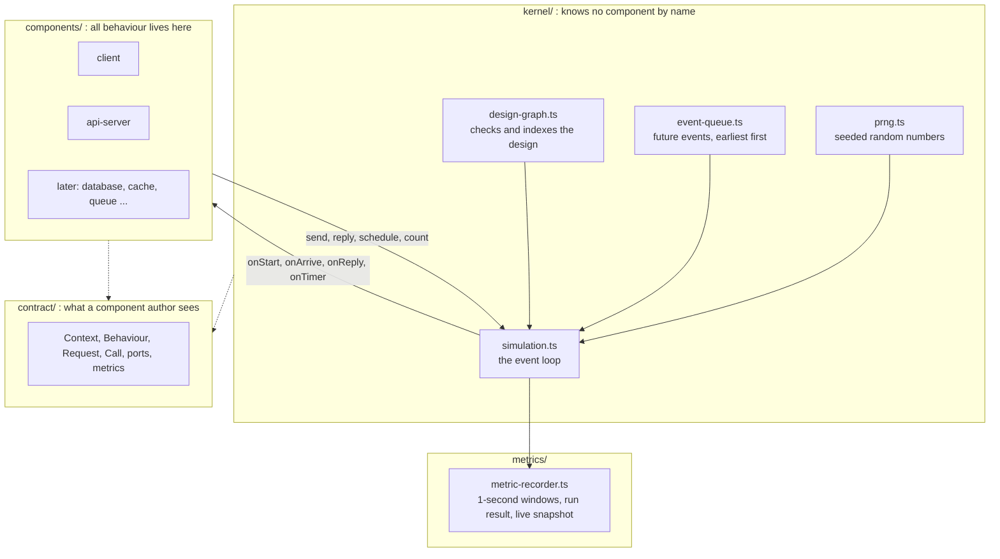
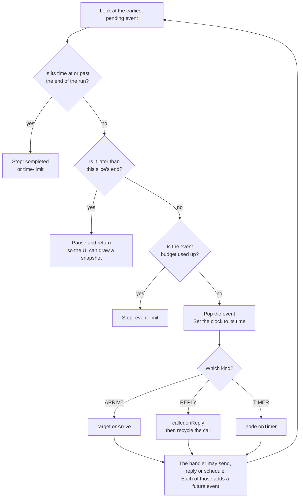
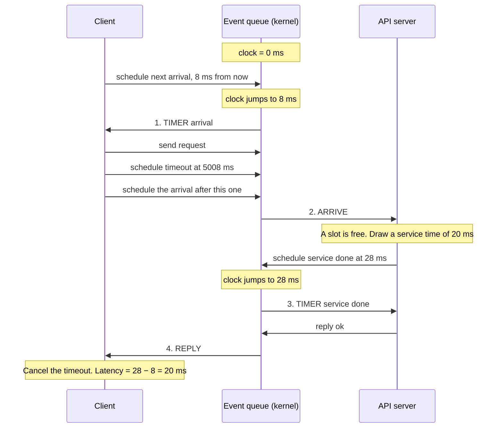
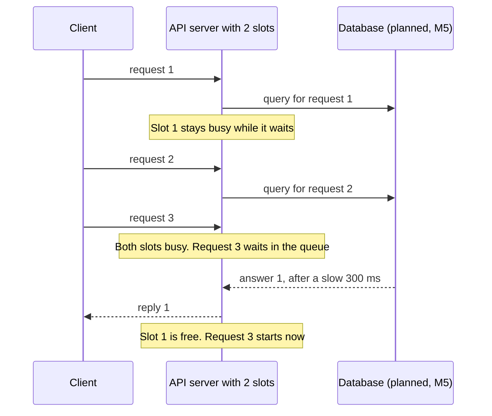
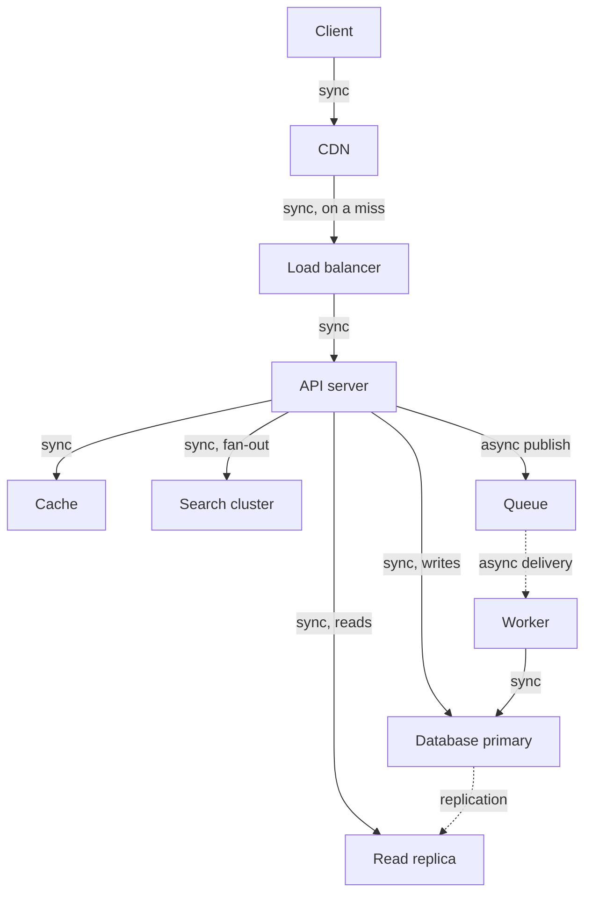
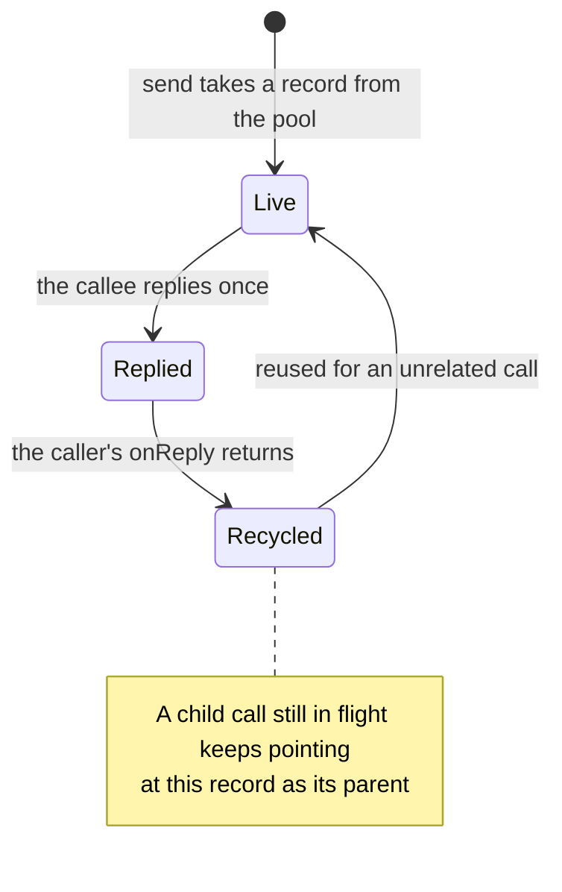

# Rectangles — Simulation Algorithm

**Status:** Proposed · **Last updated:** 2026-10-14 · Companion to [PRD.md](PRD.md) and [MilestoneBased.md](MilestoneBased.md). Realism gaps and the scale plan continue in [new-algorithm.md](new-algorithm.md)

This document explains how the engine simulates a design, why that method was chosen, how far it
will carry us as components are added, and what has to change in the kernel along the way.

File references are relative to `packages/engine/src/` and were checked on the date above. Line
numbers drift; the file names will not.

## 1. Short answer

- **The algorithm is the right one. Keep it.** The engine is a next-event discrete-event
  simulation: one clock, one time-ordered list of future events, three kinds of event. This is
  the standard method for requests queueing through components. Network simulators, queueing
  simulators and the deterministic test simulators inside databases all use it.
- **It will carry the planned components, but not unchanged.** Eight gaps (K1–K8, §7) stand
  between today's kernel and components such as a cache, read replicas or a search cluster.
  None of them changes the algorithm. They add to what a request carries and to what the kernel
  offers a component.
- **One real limit: traffic volume.** Every request is simulated individually, so very high
  rates run out of event budget. §8 gives the numbers and a four-step plan.
- **Not everything in system design is a component.** Of the 132 topics on roadmap.sh, 34 are
  boxes you place on the canvas. The rest are settings, faults, things read off the metrics, or
  out of scope (§6).

## 2. The algorithm

### 2.1 The parts



The kernel moves events and keeps the books. Components decide what happens to a request. The
two meet only through the `Context` interface (`contract/context.ts:30`), so the kernel never
asks "is this a cache?" and a component never touches the clock or the queue.

### 2.2 Time jumps, it does not tick

The clock is a single number, `nowMicros`, in whole microseconds. Nothing advances it in fixed
steps. The loop always asks "what is the next thing that happens?" and sets the clock to that
moment.

```
Tick-based, 1 ms ticks: work on every tick, even when nothing happens
|·|·|·|·|·|·|·|·|·|·|·|·|·|·|·|·|·|·|·|·|      20 steps

Next-event: go straight to the next thing that happens
●───────────────●───●─────────────────●──●     5 steps
0 ms            8   10                19 20
```

Two consequences. Quiet periods cost nothing, so run time depends on how many events happen,
not on how long the simulated period is. And latencies are exact to the microsecond, because
no event is rounded to a tick.

### 2.3 The loop

Everything the engine does is one loop, `step()` in `kernel/des/event-loop.ts:42`, which hands each event to `kernel/call-router.ts` `dispatch`.



There are only three kinds of event (`kernel/call-router.ts:13`):

| Event | Meaning | Created by | Handler |
| --- | --- | --- | --- |
| `ARRIVE` | A call reaches a component | `context.send` | `onArrive` |
| `REPLY` | An answer returns to the caller | `context.reply` | `onReply` |
| `TIMER` | A component asked to be woken later | `context.schedule` | `onTimer` |

The event list is a binary min-heap ordered by time, then by the order events were added
(`kernel/des/event-queue.ts`). The second key is what makes two events at the same microsecond
run in a fixed order. Events are stored in typed arrays and calls are reused from a pool, so
the loop allocates no memory per event.

### 2.4 One request, start to finish

This is the path through `client` and `api-server` today. It takes exactly four events.



A real run confirms the count: `pnpm sim packages/engine/examples/client-api-server.json --seed 1`
reports 59,956 requests and 239,778 events, which is 4.0 events per request. The cancelled
timeout never fires, so it is not counted.

### 2.5 Where the numbers come from

The kernel computes nothing about performance. Every metric is a by-product of the events.

| Number | How it arises | Where |
| --- | --- | --- |
| Arrival times | Random gaps drawn so arrivals follow the traffic pattern | `components/client/behaviour.ts:113` |
| Service time | The configured mean, or a random draw around it | `components/api-server/behaviour.ts:35` |
| Queue wait | Clock when service starts, minus clock when the call arrived | `components/api-server/behaviour.ts:34` |
| Utilisation | Busy slots ÷ total slots, updated whenever it changes | `components/api-server/behaviour.ts:33` |
| Queue depth | Calls waiting, updated on every join and leave | `components/api-server/behaviour.ts:74` |
| Rejections | A call arrives while the queue is at its limit | `components/api-server/behaviour.ts:68` |
| End-to-end latency | Clock at the reply, minus clock when the call was sent | `components/client/behaviour.ts:74` |

Components report these with `count`, `setGauge` and `sample`. The recorder stores them in
one-second windows (`metrics/metric-recorder.ts`). Percentiles are computed from every recorded
sample, not estimated (`metrics/sample-statistics.ts`).

### 2.6 Behaviour that emerges without being coded

No line of code says "latency rises when the server is busy". It follows from slots, a queue
and arrivals. The same is true of the behaviours the planned components need.

**Backpressure.** A component that calls downstream keeps its slot until the answer returns.
A slow database therefore fills the API server's slots, then its queue, then causes rejections.



**Timeouts that do not free capacity.** When the client gives up, it only stops waiting
(`components/client/behaviour.ts:125`). The server still finishes the work. This is what makes
retry storms appear on their own.

**Async.** A queue answers the publisher at once and does the work later. That is an ordinary
call with an early reply, so no fourth event kind is needed.

### 2.7 Why the results can be trusted

- **Deterministic.** Each node has its own random stream, seeded from the run seed and the
  node's id (`kernel/runtime-graph.ts:50`). No wall clock, no `Math.random`. The same design and
  seed give byte-identical output.
- **Checked against theory.** `tests/components/api-server/queueing-theory.test.ts` compares the
  engine with the textbook results for M/M/1, M/M/c (Erlang C) and M/M/1/K queues.
- **Requests conserved.** Every test asserts that offered = succeeded + rejected + failed +
  timed out + still in flight (`tests/support/expect-requests-conserved.ts`).
- **Guarded.** A run stops cleanly at 2,000,000 events or 600 simulated seconds
  (`kernel/simulation.ts:16`). Replying twice, or to a call that was not yours, throws
  (`kernel/call-router.ts:130`).

## 3. Why this algorithm

| Approach | How it works | Verdict for Rectangles |
| --- | --- | --- |
| **Next-event, handler style (ours)** | Jump from event to event. Each component is a set of handlers | Exact timing, fast in JavaScript, state is explicit. Chosen |
| Next-event, process style (SimPy) | Same clock and event list, but each request is written as a coroutine: "take a slot, wait 20 ms, release" | Same results, easier to read, slower: one coroutine per request. Could be added later as a way of writing components. Not needed |
| Tick-based | Advance time in fixed steps and update everything each step | Wrong below one tick (a 0.5 ms hop and a 1 ms cache vanish), and wasteful when idle |
| Analytic formulas | Compute steady-state answers from queueing theory | Instant, but cannot show ramps, spikes, tails or retries. We use it only to test the engine |
| Fluid (rate-based) | Treat traffic as flow rates, not individual requests | Handles any volume, but there are no individual requests, so no p99. Kept as a last resort (§8) |
| Equation solving (SPICE) | Solve every component simultaneously at each time step | For continuous circuits. Our components exchange discrete messages (§4) |


## 4. Lessons from circuit and Arduino simulators

Cirkit Designer's public pages and tutorial describe what its simulator does but not how it is
built, so nothing below is taken from it. Wokwi's simulator is the same kind of product and its
core, `avr8js`, is open source.

There are three families of simulator in that world. Only one resembles ours.

| Family | What it simulates | Method | Like us? |
| --- | --- | --- | --- |
| Analog (SPICE, CircuitJS) | Voltages and currents | Build one matrix from all components, solve it, repeat for each time step | No. Every part affects every other part at the same instant. Ours interact only through messages |
| Digital logic (Verilog, VHDL) | Signals changing between 0 and 1 | Event list. Zero-delay changes settle in "delta cycles" before time moves on | Yes. Same algorithm |
| Microcontroller (`avr8js`) | A CPU running real firmware | Execute instruction by instruction, counting cycles. Peripherals register "clock events" for a future cycle | Partly. The clock-event half is our algorithm; we have no CPU to step |

What `avr8js` does, and what it means for us:

| In `avr8js` | In Rectangles | Lesson |
| --- | --- | --- |
| `cpu.cycles` is the only clock | `nowMicros` | One clock, owned by the core. Confirmed |
| Clock events in a sorted list; equal deadlines run in insertion order | Heap ordered by (time, sequence) | Same tie-break rule. Ours is a heap because we hold far more pending events |
| A small pool of reusable event objects | Typed-array event slots and a call pool | Same reason: no garbage in the hot loop |
| Peripherals attach through narrow hooks on the CPU | Components receive a `Context` | Keep the hook surface small. Every K-item in §7 should be judged against this |
| Custom chips: `chip.json` for pins and attributes, `chip_init`, timers, pin watches | `definition.ts`, `init`, `schedule`, `onArrive` | Our definition/behaviour split is the established shape |
| The host runs the CPU in batches so the page stays responsive | `step(untilMicros)` | Already in place |
| The simulator lists which parts are "simulation-compatible" | `notModeled` on every component | Saying what is not simulated is normal and expected |

Three further lessons from neighbouring fields:

- **Zero-delay events deserve their own fast path.** Logic simulators keep same-instant events
  in a separate queue. Our `ARRIVE` and `REPLY` are always scheduled for "now"
  (`kernel/call-router.ts:122`, `:142`), so they could skip the heap. See §8, step 2.
- **Faults belong to the simulator, not the parts.** FoundationDB and TigerBeetle test their
  databases inside a single-threaded, seeded simulator whose network can delay, drop or
  partition messages. The components do not simulate their own failures. This is why K3 and
  K4 put latency and faults in the kernel.
- **Two engines can be joined at a boundary.** Mixed-signal tools run an analog solver and a
  digital event simulator together and synchronise them when a signal crosses a threshold. If
  we ever add a fluid mode for very high traffic, that is the pattern.

## 5. Building blocks

Every component, present or planned, is assembled from a small set of blocks. Each block is a
few lines against `Context`.

| Block | What it does | Made from |
| --- | --- | --- |
| Source | Creates requests over time | `schedule` + `createRequest` + `send` |
| Delay | Holds a call for a time | `schedule`, then `reply` |
| Server pool | N slots; a call occupies one while it is worked on | A counter + `schedule` |
| Bounded queue | Calls wait for a slot; beyond the limit they are rejected | An array + `reply(call, "rejected")` |
| Router | Passes a call to one of several targets | `targetCount` + `send(port, request, parent, targetIndex)` |
| Early reply | Answer now, do the work afterwards | `reply`, then carry on |
| Fan-out and join | Send to several targets, answer when enough have replied | Several `send`s with one parent + a counter |
| Keyed store | Remembers things per key (entries, versions, tokens) | Component state |
| State machine | Switches mode over time (open, closed, half-open) | Component state + `schedule` |

`client` is a source. `api-server` is a server pool with a bounded queue. How the planned and
likely components are built:

| Component | Blocks | What emerges | Needs |
| --- | --- | --- | --- |
| Load balancer | Router (weighted, by connection settings), delay, state machine per target for ejection | Weighted split, slow targets avoided (least connections, least time), ejection and flapping under overload | Built (`components/load-balancer/`) |
| Database | Server pool, bounded queue | Connection-pool exhaustion; writes slower than reads | K1 |
| Read replica | Database + a stream of writes from the primary | Replication lag, stale reads | K1, K2, K3 |
| Cache | Keyed store (LRU, TTL), delay | Hit rate from key skew, capacity and TTL | K1, K2, K7 |
| Queue | Bounded queue, early reply, state machine for redelivery | Backlog, dead letters | — |
| Worker | Server pool, calls downstream | Backlog drains at worker capacity | — |
| CDN | Cache + router to the origin on a miss | Origin offload, cold-cache surge | K1, K2, K3 |
| DNS | Keyed store with TTL, delay on a miss | Slow first request, failover delay | K3 |
| Search cluster (Elasticsearch) | Fan-out to N shards, join on all, server pool per shard | Slowest shard sets the latency | K1, K5, K6 |
| Edge function | Server pool, cold-start delay | Fast when warm; latency to the origin dominates | K3 |
| Rate limiter | Keyed store (token bucket), reject | Throttling per client | K1 |
| Circuit breaker | State machine, early reply | Fails fast, then recovers | K5 |
| API gateway | Router, fan-out and join | Aggregated calls wait for the slowest part | K5, K6 |
| Object store | Delay that grows with size | Large objects dominate latency | K1 |
| Stream broker | Router by key to partitions, bounded queue | Hot partitions, consumer lag | K1 |
| Autoscaling | State machine that changes a pool's slot count after a delay | Lag between load rising and capacity arriving | — |

A design that uses most of these:



Every arrow here is the same thing to the kernel: a call that will get one reply. That is why
the algorithm does not need to grow as the library does.

## 6. roadmap.sh coverage map

The [system design roadmap](https://roadmap.sh/system-design) has 132 topics (list taken from
its repository on 2026-10-14). They fall into six buckets, plus the roadmap's own section
headings. The sorting is my judgement, not something the roadmap states.

| Bucket | Count | Topics | How Rectangles treats them |
| --- | --- | --- | --- |
| **A. Components**: traffic entry and routing | 13 | Load balancers · Layer 4 load balancing · Layer 7 load balancing · LB vs reverse proxy · Domain name system · Content delivery networks · Pull CDNs · Push CDNs · Gateway routing · Gateway aggregation · Gateway offloading · Backends for frontend · Service discovery | A box with ports, or a mode of one |
| **A. Components**: compute | 5 | Application layer · Microservices · Background jobs · Sidecar · Ambassador | API server and worker, composed |
| **A. Components**: data stores | 7 | Databases · SQL vs NoSQL · Key-value store · Document store · Wide column store · Graph databases · Static content hosting | Database and object store, with different service times and limits |
| **A. Components**: caches | 6 | Caching · Application caching · Database caching · Web server caching · CDN caching · Client caching | One cache component, placed at different points |
| **A. Components**: messaging | 3 | Message queues · Task queues · Publisher/subscriber | Queue and stream broker |
| **B. Policies**: scaling and data layout | 12 | Load balancing algorithms · Horizontal scaling · Replication · Fail-over · Sharding · Federation · Denormalization · SQL tuning · Materialized view · Index table · CQRS · Event sourcing | A setting on a component, or a way of wiring several |
| **B. Policies**: cache strategies | 4 | Cache-aside · Write-through · Write-behind · Refresh-ahead | A choice field on the cache or its caller |
| **B. Policies**: resilience | 8 | Retry · Circuit breaker · Bulkhead · Throttling · Back pressure · Health endpoint monitoring · Compensating transaction · Leader election | Settings on a caller's out port, or a small component. Leader election is the heavy one (§9) |
| **B. Policies**: messaging and jobs | 14 | Queue-based load leveling · Competing consumers · Priority queue · Async request reply · Returning results · Event-driven · Schedule-driven · Pipes & filters · Pipes and filters · Sequential convoy · Claim check · Choreography · Scheduler agent supervisor · Scheduling agent supervisor | Wiring patterns of queue and worker; good template material |
| **B. Policies**: deployment shape | 3 | Deployment stamps · Geodes · Compute resource consolidation | Several copies of a sub-design with latency between them (K3) |
| **C. Workload attributes** | 1 | Idempotent operations | A property of the request (K1). Read/write mix, key skew and payload size belong here too, though the roadmap does not list them |
| **D. Environment and faults** | 6 | CAP theorem · Availability vs consistency · Consistency patterns · Weak consistency · Eventual consistency · Strong consistency | Visible once links can be delayed or cut (K3, K4) and replies carry a version (K2) |
| **E. Read off the metrics** | 19 | Performance vs scalability · Latency vs throughput · Availability in numbers · Busy database · Busy frontend · Chatty I/O · Extraneous fetching · Improper instantiation · Monolithic persistence · No caching · Noisy neighbor · Retry storm · Synchronous I/O · Health monitoring · Availability monitoring · Performance monitoring · Usage monitoring · Instrumentation · Visualization & alerts | Not simulated. They are what the charts and the bottleneck explanation show |
| **F. Out of scope** | 14 | Security monitoring · Federated identity · Gatekeeper · Valet key · Strangler fig · Anti-corruption layer · External config store · HTTP · RPC · REST · gRPC · GraphQL · TCP · UDP | Not about capacity or latency. A protocol's cost appears only as link latency and payload size |
| Section headings | 17 | Introduction · What is system design · How to approach system design · Performance antipatterns · Monitoring · Cloud design patterns · Design & implementation · Data management · Messaging · Reliability patterns · Availability · High availability · Resiliency · Security · Availability patterns · Asynchronism · Communication | Groupings, not topics |

Leaving out the 17 headings, 115 topics remain: 82 the engine simulates or can simulate
(A to D), 19 are read off the metrics, and 14 are out of scope.

## 7. Kernel backlog

These are the gaps between today's kernel and the table in §5. MilestoneBased.md §5.1 already
expects this: a component that needs a new primitive is a design gap to be logged and fixed in
the kernel interface. This is that log.

Names are proposals. Each is settled when its first component needs it.

| # | Gap | Change | Touches | First needed |
| --- | --- | --- | --- | --- |
| K1 | A request carries nothing but `id`, `attempt` and `createdAtMicros` (`contract/request.ts:14`) | Add `operation` (`"read"` or `"write"`) and `key`. Later `sizeBytes` and `deadlineMicros` | `contract/request.ts`, `createRequest` | M5 database, M6 cache |
| K2 | A reply carries only an outcome (`contract/context.ts:59`) | `context.reply(call, outcome, replyValue)`; the caller reads `call.replyValue`. A number, so nothing is allocated | `contract/`, `kernel/call-router.ts` `reply` | M6 cache (hit or miss) |
| K3 | Links are instant (`kernel/call-router.ts` `send`, `reply`). Edges can carry settings now, but only ones a component reads (`PortSpec.connectionFields`, `SetupContext.connections`) | Add a kernel-owned `latencyMs` connection setting on every edge. The kernel delays `ARRIVE` and `REPLY` by it | `kernel/design-graph.ts`, `send`, `reply` | CDN, edge function, regions |
| K4 | Components cannot be told about a failure (`contract/component-definition.ts:26`) | Run settings gain a fault schedule. The kernel delivers each fault to an optional `onFault` handler. Link faults are handled by the kernel itself | `contract/`, `kernel/` | M7 experiments |
| K5 | A call can be reused while its children still point at it (`kernel/call-pool.ts:43`) | Keep a call out of the pool until its children have finished. Add `call.isOpen` so a late child can tell its parent was already answered | `kernel/call-pool.ts`, `kernel/call-router.ts` | Before the first component that answers early |
| K6 | Two scratch numbers per side of a call (`contract/request.ts:35`) | Expose a stable per-call index so a component can keep its own typed arrays | `contract/request.ts` | Search cluster, API gateway |
| K7 | Random draws are uniform or exponential only (`contract/context.ts:7`) | Helpers in `contract/` built on `nextFloat`: a Zipf sampler for key skew, a gamma draw for service-time spread. No kernel change | `contract/` | M6 cache |
| K8 | Runs stop at 2,000,000 events (`kernel/simulation.ts:16`) | See §8 | `kernel/` | High-traffic designs |

**K5 in detail.** This is the only item that is a defect and not a missing feature. It was found
by reading the code and has not yet been reproduced with a test.



Today nothing triggers it, because `api-server` makes no downstream calls. It will trigger as
soon as a middle component answers its caller before its own downstream call returns: a
timeout towards the database, a circuit breaker, a quorum read, a hedged request. The late
reply would then be matched to whatever unrelated request now occupies the record.

**Things that look like gaps and are not:**

- *One-way messages.* A publish is a call with an immediate reply.
- *Workers pulling from a queue.* The queue sends up to a set number of unanswered deliveries
  to each worker. The worker's reply is the acknowledgement.
- *Cycles.* The kernel handles them. The rules package rejects them in the MVP for the user's
  sake, and the event limit stops a runaway loop.
- *Autoscaling and crashes.* A component changes its own slot count. Only the trigger (K4) is new.

## 8. Scale

### 8.1 The budget

Measured on an Apple M2 (`packages/engine/bench/baseline.json`): 2.1 to 2.3 million events per
second. A run is limited to 2,000,000 events, so the limit is reached in about one second of
real time. The cap, not the speed, is what binds first.

| Path | Events per request | Requests per run | A 60 s run fits |
| --- | --- | --- | --- |
| Client → API server | 4.0 (measured) | 500,000 | about 8,300 requests/s |
| Client → load balancer → API server → database | about 10 (estimate) | 200,000 | about 3,300 requests/s |
| The same, plus a cache | about 13 (estimate) | 150,000 | about 2,500 requests/s |

The estimates assume three events for each extra hop: an arrival, a timer and a reply.

This is enough to teach every behaviour in the PRD. Saturation at 2,000 requests/s looks the
same as at 2,000,000. It is not enough to type "1 million requests/s" from an interview
question into the client and press Run.

### 8.2 Four steps, cheapest first

| Step | What | Results change? | Gain | Status |
| --- | --- | --- | --- | --- |
| 1 | Exact mode with clear limits | — | — | Built |
| 2 | Kernel speed-ups: a same-instant lane for `ARRIVE` and `REPLY`, then a higher event cap | No. Snapshot tests must stay byte-identical | Unknown until benchmarked. Perhaps 10× on the cap | Do when a real design hits the cap |
| 3 | Scale model: simulate 1 in k requests against 1/k of the capacity, labelled in the product | Yes, slightly | k× | Design later; verify against exact mode first |
| 4 | Hybrid: bulk traffic as flow rates, a sample of real requests on top | Yes | Large (about 20× reported in network simulation) | Researched. Not planned |

**Step 2.** `ARRIVE` and `REPLY` are always scheduled for the current instant, yet each pays
for a heap insert and removal. A plain first-in-first-out lane for same-instant events, merged
with the heap by comparing (time, sequence), keeps the order identical. Once K3 gives a link
latency, only zero-latency links benefit. Measure with `pnpm bench` before and after; keep it
only if it wins.

**Step 3.** If 100 instances share 100,000 requests/s, then 10 instances sharing 10,000 behave
almost the same per instance. Two cautions. A large pool queues less than a small one at the
same utilisation, so scaling a pooled component down overstates waiting near saturation.
And key-based behaviour does not shrink simply: a cache's hit rate depends on the real number
of keys. So this mode must be checked against exact mode on mid-sized cases, and the product
must say "simulating 1 in k" whenever it is on.

**Step 4** gives up the PRD's principle that every number comes from an individual request.
It stays on paper unless step 3 proves insufficient.

## 9. Exceptions

What this algorithm will not do, and where each case goes.

| Case | Why | What we do |
| --- | --- | --- |
| CPU, memory, garbage collection, disk | These are inside the box. The engine models what a box does to a request, not why | Represented by service time and concurrency. Listed in `notModeled`. A "service time rises with load" setting can come later |
| TCP windows, packet loss, retransmission | Byte-level detail far below a request | Links get latency (K3) and, later, loss. Nothing finer |
| Consensus and leader election | Expressible (they are messages and timers) but a large modelling effort per protocol | Later. Until then, failover is a timed switch |
| What data is actually stored | We track that a key was written and which version, not its value | Staleness and hit rate are measurable; correctness of contents is not |
| Security and migration patterns | Not about capacity or latency | Out of scope (§6, bucket F) |
| Cost | Needs pricing data that goes stale | Later, per PRD §10 |
| Very high request rates | One object per request | §8 |

The rule for any new exception: it must end up in exactly one of three places. A component's
`notModeled` list, the bottleneck explanation rules, or the out-of-scope bucket. Nothing is left
silently unmodelled.

## 10. Staying on track

**Invariants. A change that breaks one is wrong, however useful.**

1. Same design and seed give byte-identical output.
2. Requests are conserved in every test.
3. No `if (type === "...")` in the kernel. A component is one folder and one registry line.
4. Components import only `contract/` and their own folder.
5. `pnpm bench` stays above 500,000 events per second.
6. Every component passes the conformance suite (`packages/engine/tests/registry.test.ts`).

**Checklist for a new component.**

1. Which blocks from §5 is it made of? If it needs one that is not listed, stop: that is a
   kernel-interface question.
2. Which K-items does it need? Land those first, each with its own test.
3. What emerges from it that no setting dictates? If nothing does, it may be a setting on an
   existing component, not a new one.
4. What does it not model? Write the `notModeled` list before the behaviour.
5. Which textbook result or hand calculation can check it?

**Kernel change log.** One row per K-item as it lands.

| Item | Status | Landed in | Kernel files changed | Proved by |
| --- | --- | --- | --- | --- |
| K1 Request payload | Open | | | |
| K2 Reply value | Open | | | |
| K3 Link latency | Partly: connection settings landed; latency open | Load balancer weights | `contract/port.ts`, `contract/context.ts`, `kernel/design-graph.ts`, `kernel/simulation.ts` | `tests/kernel/design-graph.test.ts`, `tests/kernel/simulation.test.ts` |
| K4 Faults | Open | | | |
| K5 Call lifetime | Open | | | |
| K6 Per-call index | Open | | | |
| K7 Random helpers | Open | | | |
| K8 Volume | Open | | | |

